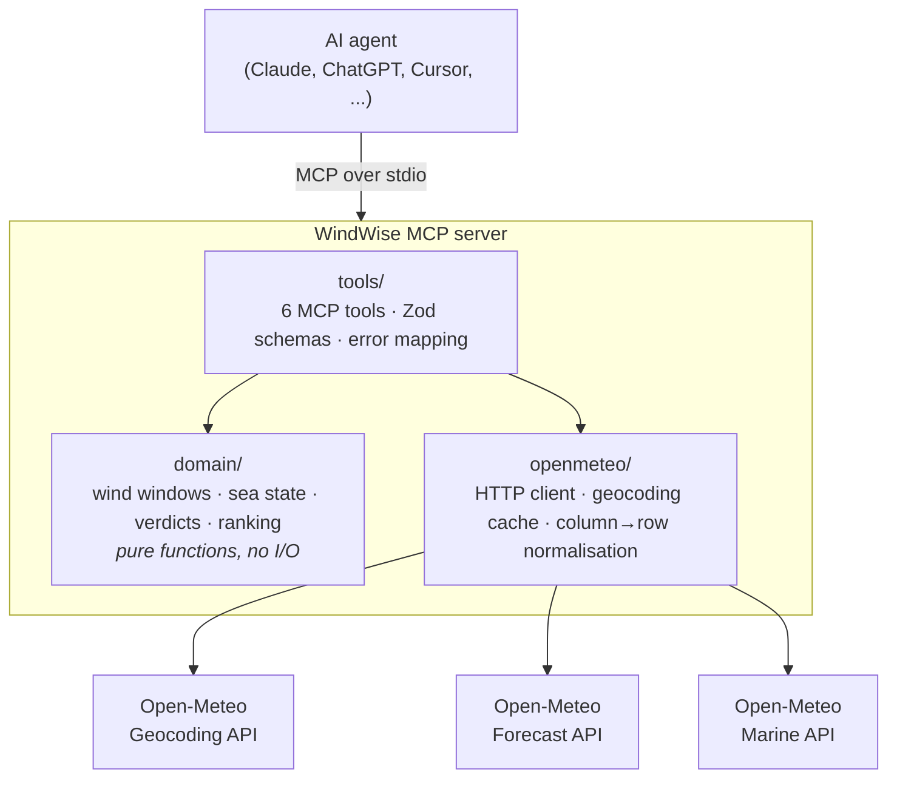

# WindWise MCP

[](https://github.com/kacaben/windwise-mcp/actions/workflows/ci.yml)


> A portfolio project, not production weather advice. Forecasts are model output; see
> [Limitations](#limitations-and-roadmap).

**An MCP server that lets AI agents answer "should I go out on the water?"** It combines
[Open-Meteo](https://open-meteo.com/)'s weather and marine forecasts and adds wind-sport
logic on top. It finds rideable wind windows, rates sea state, compares spots and gives
a go / marginal / no-go call with reasons.

It is not just a thin API wrapper. The API returns raw hourly columns. WindWise turns them
into the answers a kite or wing-foil rider actually needs, and is honest about forecast
uncertainty.

```
(illustrative conversation)
You:    Will there be enough wind for wing foiling in Bucerías tomorrow?
Agent:  → get_weather_summary { location: "Bucerias, Mexico", day: "tomorrow" }
        Probably not. The forecast peaks at 5.2 kn around 17:00, well below a 12 kn
        minimum. Skies are clear and it's 26–30 °C, with small 0.7 m waves from the WNW,
        so it's a good SUP or swim day instead. (Open-Meteo model forecast; local
        thermals can add a few knots.)
```

---

## Tools

| Tool                    | What it answers                                | Business logic beyond the API                                                                                       |
| ----------------------- | ---------------------------------------------- | ------------------------------------------------------------------------------------------------------------------- |
| `get_weather`           | "What's the weather in Sayulita?"              | Weather codes → words, degrees → compass points, trims to the next _N_ hours                                        |
| `get_wind_forecast`     | "When is the wind strongest between 10 and 5?" | Per-day rollup: average/peak/peak time, strongest gust, **circular-mean** prevailing direction, Beaufort            |
| `get_marine_conditions` | "Are the waves OK for a beginner?"             | Sea-state rating that treats short-period chop as harder than swell; detects inland points                          |
| `find_wind_windows`     | "When is it 12–22 kn with gusts under 25?"     | Finds continuous windows across days, filters by direction and thunderstorms, **explains why** when nothing matches |
| `compare_locations`     | "Bucerías or La Cruz tomorrow?"                | Ranks 2–5 spots, tolerates partial failures, **flags spots in the same model grid cell**                            |
| `get_weather_summary`   | "Should I go out tomorrow?"                    | Combines weather and marine into a go / marginal / no-go verdict with human-readable reasons                        |

All tools are read-only (`readOnlyHint`) and validate their input with Zod. Each one publishes an
`outputSchema`, returns both text and `structuredContent`, and includes Open-Meteo attribution
and a forecast caveat. Forecasts always start from the current local hour, so a tool never
offers a wind window that has already passed.

### Activity presets

`find_wind_windows`, `compare_locations` and `get_weather_summary` accept an `activity`
instead of raw knots. Any explicit `min_wind_knots`, `max_wind_knots` or `max_gust_knots`
overrides the preset.

| `activity`       | Wind range   |
| ---------------- | ------------ |
| `wing_foiling`   | 12 kn and up |
| `dinghy_sailing` | 10–18 kn     |

With no activity and no `min_wind_knots`, the minimum defaults to 12 kn. All three tools
share `min_window_hours` (default 2), so they agree on what counts as a usable session.
To add a preset, add one line to `ACTIVITY_PRESETS` in `src/domain/activities.ts`. The tool
schemas and descriptions pick it up automatically.

A preset's maximum is not silently dropped: `activity: "dinghy_sailing"` with
`min_wind_knots: 20` fails with a message saying the 18 kn cap comes from the preset, and
asks you to pass `max_wind_knots` as well.

### Example: `find_wind_windows`

```jsonc
// Input
{
  "location": "Bucerias, Mexico",
  "min_wind_knots": 12,
  "max_wind_knots": 22,
  "max_gust_knots": 25,
  "start_hour": 9,
  "end_hour": 18,
  "directions": ["W", "WSW", "WNW", "SW"]   // onshore/cross-shore for this beach
}

// Output (illustrative values, abridged)
{
  "found": true,
  "bestWindow": {
    "date": "2026-11-09", "start": "2026-11-09T13:00", "end": "2026-11-09T17:00",
    "durationHours": 4, "avgWindKn": 14.6, "maxWindKn": 16.8, "maxGustKn": 21.3,
    "direction": "WSW", "gusty": false
  },
  "windows": [ ... ],
  "attribution": "Weather data by Open-Meteo.com (CC BY 4.0) - https://open-meteo.com/"
}
```

When nothing matches, the tool still gives the agent something useful to say:

```jsonc
{
  "found": false,
  "whyNoWindows": { "too_light": 27 },
  "strongestHourInRange": { "time": "2026-11-06T15:00", "windKn": 7.8, "gustKn": 21, "direction": "NNW" }
}
```

---

## Architecture



```
src/
├── index.ts               # stdio entry point
├── server.ts              # creates the McpServer and registers every tool
├── tools/                 # MCP layer: schemas, descriptions, response shaping
│   ├── shared.ts          #   shared input schemas, result/error helpers
│   ├── outputs.ts         #   output schemas, type-checked against the domain types
│   └── *.ts               #   one file per tool
├── domain/                # business logic, pure and unit-tested
│   ├── wind.ts            #   findWindWindows, summarizeWindByDay, rejection reasons
│   ├── marine.ts          #   assessWaves, summarizeMarineByDay
│   ├── summary.ts         #   sessionVerdict (go / marginal / no_go)
│   ├── compare.ts         #   rankLocations, sharedGridCells
│   ├── activities.ts      #   activity presets (wing foiling, dinghy sailing)
│   ├── session.ts         #   the remaining hours of a day's session
│   ├── units.ts           #   compass, circular mean, Beaufort, conversions
│   ├── time.ts            #   time-zone-safe local time helpers, days-from-now trimming
│   ├── stats.ts           #   null-safe mean / max / min / sum / groupBy
│   ├── weatherCodes.ts    #   WMO weather codes → words, thunderstorm check
│   ├── disclaimers.ts     #   attribution and forecast caveats
│   └── errors.ts          #   ToolInputError (messages safe to show the model)
└── openmeteo/             # integration layer
    ├── http.ts            #   timeouts, retry with backoff, typed errors
    ├── geocoding.ts       #   place search, disambiguation, bounded LRU cache
    ├── forecast.ts        #   weather API → WeatherHour[]
    ├── marine.ts          #   marine API → MarineHour[]
    ├── columns.ts         #   column-wise API arrays → row records
    └── client.ts          #   WeatherService interface (what tools depend on)
```

### Design decisions

- **Tools depend on an interface, not on HTTP.** `WeatherService` is injected into every
  tool, so the integration tests run a real MCP client against the real server with a fake
  service, with no network and no mocks of `fetch` at that level.
- **Business logic is pure.** Everything in `domain/` takes arrays and returns data. That is
  where the interesting behaviour lives, and it is where most of the tests are.
- **Errors are for the model to read, bugs are for the developer.** Known failures come back
  as `isError` tool results with an actionable message ("Did you mean: ...", 'try day
  "tomorrow"'). Anything unexpected is logged to stderr and the model gets a generic message,
  never internals like "Cannot read properties of undefined". Bad Open-Meteo requests (400)
  are not retried. Timeouts, network errors, 429 and 5xx are retried once with backoff.
- **Outputs are typed twice.** Each tool declares an `outputSchema`, and the SDK validates every
  result against it at runtime. `jsonResult(schema, data)` also checks `data` against the
  schema at compile time, and the shared schemas are typed against the domain interfaces, so
  the published contract can't silently drift from the code.
- **Wind over the water, not the town.** Open-Meteo snaps to a land grid cell by default. The
  wind tools ask for `cell_selection=sea`, which picks the neighbouring water cell for a beach
  and leaves inland points alone. For Bucerías that changes the 9:00 wind from 3.2 to 5.2 kn.
  `get_weather` keeps the land cell, because it describes the weather in town.
- **Forecasts start now.** Open-Meteo returns the day from midnight. Every tool drops the hours
  that have already passed, and `get_weather_summary` for "today" judges only the rest of the
  session, or says the session is over. A `days` argument means 24-hour periods from the
  current hour (the server asks Open-Meteo for one extra calendar day and trims), so
  `days: 1` at 22:30 still returns a full day ahead.
- **Place qualifiers match whole words.** In "Sydney, US", `US` must be a country code or a
  whole word in the country/region name, not any name containing the letters "us" (such as
  "Australia").
- **Local time only, with no time-zone arithmetic.** Requests use `timezone=auto`, so every
  timestamp is already local to the spot. Times are handled as strings, so the server's own
  time zone can never shift a forecast hour. "Today" means _today at the spot_, taken from
  the forecast itself.
- **Directions are averaged correctly.** The mean of 350° and 10° is 0°, not 180°.
  Prevailing direction uses a vector (circular) mean.
- **Honesty about uncertainty.** Every response carries a caveat. The marine caveat repeats
  Open-Meteo's own warning about ~5 km resolution near coasts. `compare_locations` says
  so when two towns share a model grid cell instead of pretending one is better. That
  happens with Bucerías and La Cruz de Huanacaxtle.
- **Graceful partial failure.** `get_weather_summary` still answers for a lake with no marine
  data. `compare_locations` still ranks the spots it could resolve and lists the ones it couldn't.
- **Agent-oriented descriptions.** Each tool description says when to use it rather than a
  sibling tool. The server also sends `instructions` (units, local time, which tool to start
  with) to clients that support them.

---

## Getting started

Requires **Node.js 22 or newer**. No API key is needed.

```bash
git clone https://github.com/kacaben/windwise-mcp.git
cd windwise-mcp
npm install
npm run build
```

### Use it from Claude Code

```bash
claude mcp add windwise -- node /absolute/path/to/windwise-mcp/dist/index.js
```

### Use it from Claude Desktop (or any stdio MCP client)

Add this to `claude_desktop_config.json`:

```json
{
  "mcpServers": {
    "windwise": {
      "command": "node",
      "args": ["/absolute/path/to/windwise-mcp/dist/index.js"]
    }
  }
}
```

Then try asking:

- _"Will there be enough wind for wing foiling in Bucerías tomorrow?"_
- _"Show me the wind forecast for the next three days between 10 AM and 5 PM."_
- _"Find 2-hour windows of 15–25 knots from the west in Cabarete this week."_
- _"When could I go dinghy sailing in Bucerías this week?"_
- _"Compare Bucerías, La Cruz de Huanacaxtle and Sayulita for tomorrow afternoon."_
- _"Are the waves likely to be manageable for a beginner in Sayulita?"_

You can also explore the tools interactively with the MCP Inspector:

```bash
npx @modelcontextprotocol/inspector node dist/index.js
```

---

## Development

| Command             | What it does                                                                                                     |
| ------------------- | ---------------------------------------------------------------------------------------------------------------- |
| `npm run dev`       | Run the server from source with `tsx`                                                                            |
| `npm run lint`      | Biome lint and format check, failing on warnings (`npm run format` fixes what it can)                            |
| `npm run typecheck` | Strict TypeScript check of `src`, `tests` and `scripts`                                                          |
| `npm test`          | Unit and integration tests (Vitest, no network)                                                                  |
| `npm run build`     | Compile to `dist/`                                                                                               |
| `npm run smoke`     | **Live** end-to-end test: spawns `dist/index.js` over stdio and calls every tool against the real Open-Meteo API |

### Tests

- **Domain unit tests:** wind windows (gaps, limits, direction filters, thunderstorms,
  midnight crossings, missing data), sea-state ratings, verdicts, ranking, activity presets,
  units, local time and session-hour selection.
- **Integration-layer tests:** query building, Open-Meteo error payloads, retry/backoff,
  timeouts, geocoding disambiguation (including the "Sydney, US" regression), "did you mean"
  suggestions, LRU eviction, column-to-row normalisation and inland detection. These use a
  fake `fetch`.
- **MCP server tests:** a real `Client` connected through `InMemoryTransport` checks tool
  listing, input and output schemas, validation errors, past-hour filtering, grid-cell choice,
  hidden internal errors and end-to-end tool behaviour with a fake `WeatherService`.

CI runs lint, typecheck, tests and build on Node 22 and 24 for every push and pull request. A
separate weekly workflow runs the live smoke test to catch upstream API changes.

### Adding a tool

1. Put any new logic in `src/domain/` as pure functions, and unit-test it.
2. Create `src/tools/yourTool.ts` exporting `registerYourTool(server, service)`:
   - build the input schema with `withLocation({...})` from `tools/shared.ts`
   - write a description that says _when_ an agent should pick this tool
   - define its `outputSchema` in `tools/outputs.ts`
   - wrap the handler in `safely(...)` and return `jsonResult(outputSchema, {...})`
   - throw `ToolInputError` for problems the model should see and fix
3. Add it to the `TOOLS` list in `src/server.ts`.
4. Add a case to `tests/server.test.ts`, and a call to `scripts/smoke.ts`.

If a tool needs new Open-Meteo data, add the variable to the relevant `HOURLY_VARIABLES`
list in `src/openmeteo/` and map it onto the typed hour interface.

---

## Limitations and roadmap

- These are model forecasts. Sea breezes and thermal winds, which matter a lot in Banderas
  Bay, are often under-forecast by global models.
- Marine data has ~5 km resolution and is less reliable inside bays and near the shore.
- Wave ratings are deliberately simple and conservative. They are a hint, not safety advice.
- The go / marginal / no-go verdict looks at wind, gusts, thunderstorms and waves. It ignores
  rain, temperature and the rider's skill level.
- The wind tools use the sea grid cell, so the temperature and rain in `get_weather_summary`
  describe the water cell, not the town. `get_weather` uses the land cell.
- `compare_locations` takes place names only, not coordinates, and waves are just a
  tie-breaker in its ranking.
- Open-Meteo responses are trusted as-is. A changed or missing field shows up as "no data"
  instead of a clear API-changed error.
- Forecasts are not cached (only place lookups are), and a rate-limited request is retried
  once after a short delay, ignoring `Retry-After`.
- Prevailing direction is an unweighted vector mean, so a few calm hours from another
  direction can pull it around.

Ideas for later:

- [ ] Validate Open-Meteo responses with Zod at the boundary
- [ ] Short-TTL forecast cache and `Retry-After` handling
- [ ] Coordinates and a direction filter for `compare_locations`; weigh waves in the ranking
- [ ] Skill-level input for the sea-state rating and verdict
- [ ] Compare several weather models (ECMWF, GFS, ICON) side by side to show forecast spread
- [ ] Verify past forecasts against Open-Meteo's historical data to measure local bias
- [ ] Tide data, and "offshore wind" warnings computed from each spot's beach orientation
- [ ] Streamable HTTP transport for remote deployment

---

## Attribution and license

Weather data by [Open-Meteo.com](https://open-meteo.com/), licensed under
[CC BY 4.0](https://creativecommons.org/licenses/by/4.0/). The free Open-Meteo API is for
non-commercial use.

Code licensed under the [MIT License](LICENSE).
