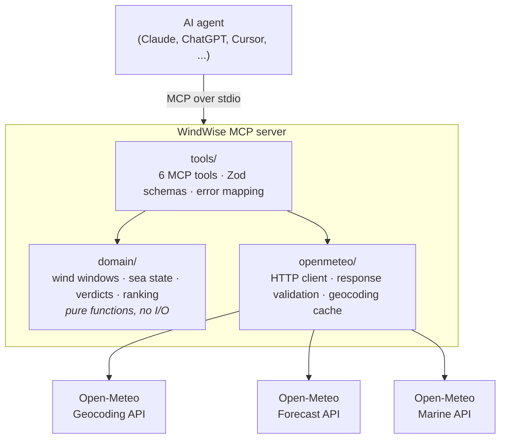

# WindWise MCP architecture

This document explains how WindWise is put together and why. For what the tools do and how
to run them, see the [README](../README.md).

## Layers



```
src/
├── index.ts               # stdio entry point
├── server.ts              # creates the McpServer and registers every tool
├── version.ts             # the single source of the version in code
├── tools/                 # MCP layer: schemas, descriptions, response shaping
│   ├── shared.ts          #   shared input schemas, wind-range resolution, result/error helpers
│   ├── outputs.ts         #   output schemas, type-checked against the domain types
│   └── *.ts               #   one file per tool
├── domain/                # business logic, pure and unit-tested
│   ├── wind.ts            #   findWindWindows, bestWindow, peakHour, summarizeWindByDay, rejection reasons
│   ├── marine.ts          #   assessWaves, worstHour, summarizeMarineByDay
│   ├── summary.ts         #   sessionVerdict (go / marginal / no_go)
│   ├── compare.ts         #   rankLocations, sharedGridCells
│   ├── activities.ts      #   activity presets (wing foiling, dinghy sailing)
│   ├── session.ts         #   the remaining hours of a day's session
│   ├── units.ts           #   compass, circular mean, Beaufort
│   ├── time.ts            #   time-zone-safe local time helpers, days-from-now trimming
│   ├── stats.ts           #   null-safe mean / max / min / sum / groupBy
│   ├── weatherCodes.ts    #   WMO weather codes → words, thunderstorm check
│   ├── disclaimers.ts     #   attribution and forecast caveats
│   └── errors.ts          #   ToolInputError (messages safe to show the model)
└── openmeteo/             # integration layer
    ├── http.ts            #   timeouts, retry with backoff, typed errors
    ├── schemas.ts         #   Zod validation of every Open-Meteo response
    ├── geocoding.ts       #   place search, disambiguation, bounded LRU cache
    ├── forecast.ts        #   weather API → WeatherHour[]
    ├── marine.ts          #   marine API → MarineHour[]
    ├── columns.ts         #   column-wise API arrays → row records
    └── client.ts          #   WeatherService interface (what tools depend on)
```

## Design decisions

### Structure

- **Tools depend on an interface, not on HTTP.** `WeatherService` is injected into every
  tool, so the integration tests run a real MCP client against the real server with a fake
  service, with no network and no mocks of `fetch` at that level.
- **Business logic is pure.** Everything in `domain/` takes arrays and returns data. That is
  where the interesting behaviour lives, and it is where most of the tests are.
- **One definition of a usable session.** `find_wind_windows`, `compare_locations` and
  `get_weather_summary` resolve their wind arguments through the same `windSearch` helper, so
  they agree on the criteria and report the range the same way.

### Correctness at the edges

- **Responses are validated at the boundary.** Every Open-Meteo response is checked with Zod
  before use: each requested hourly variable must be present, numeric (or null) and as long as
  the time axis, and timestamps must be naive local times. An API change becomes one
  `invalid_response` error that is logged with the details, not nulls that read as "no data"
  or a crash deep in the domain code. It is not retried, because retrying won't help.
- **Errors are for the model to read, bugs are for the developer.** Known failures come back
  as `isError` tool results with an actionable message ("Did you mean: ...", 'try day
  "tomorrow"'). Anything unexpected is logged to stderr and the model gets a generic message,
  never internals like "Cannot read properties of undefined". Bad Open-Meteo requests (400)
  are not retried. Timeouts, network errors, 429 and 5xx are retried once with backoff.
- **Cancellation reaches the network.** When an MCP client cancels a tool call, the request's
  abort signal is passed to every forecast and marine `fetch`, and no retry starts after it.
  Geocoding is the exception: lookups are cached and shared between calls, so one cancelled
  call must not cancel another's lookup.
- **Outputs are typed twice.** Each tool declares an `outputSchema`, and the SDK validates
  every result against it at runtime. `jsonResult(schema, data)` also checks `data` against
  the schema at compile time, and the shared schemas are typed against the domain
  interfaces, so the published contract can't silently drift from the code.

### Weather logic

- **Wind over the water, not the town.** Open-Meteo snaps to a land grid cell by default. The
  wind tools ask for `cell_selection=sea`, which picks the neighbouring water cell for a beach
  and leaves inland points alone. For example, on the day this was checked, it changed the
  9:00 wind in Bucerías from 3.2 to 5.2 kn. `get_weather` keeps the land cell, because it
  describes the weather in town.
- **Forecasts start now.** Open-Meteo returns the day from midnight. Every tool drops the
  hours that have already passed, and `get_weather_summary` for "today" judges only the rest
  of the session, or says the session is over. A `days` argument means 24-hour periods from
  the current hour (the server asks Open-Meteo for one extra calendar day and trims), so
  `days: 1` at 22:30 still returns a full day ahead.
- **Local time only, with no time-zone arithmetic.** Requests use `timezone=auto`, so every
  timestamp is already local to the spot. Times are handled as strings, so the server's own
  time zone can never shift a forecast hour. "Today" means _today at the spot_, taken from
  the forecast itself. When `compare_locations` compares spots in different time zones,
  "today" can be a different date at each one, so the tool says so instead of reporting one
  date.
- **Sea state is rated hour by hour.** Each hour is rated from its wave height. Short-period
  chop (under 6 s, 0.5 m or more) is rated one level rougher than swell of the same height,
  because it is steeper and harder to ride through. A day takes the rating of its worst hour,
  so 1 m of chop can outrank 1.4 m of long swell.
- **Verdicts explain themselves.** When no wind window is found, `get_weather_summary` leads
  with the reason that rejected the most hours (too light, too windy, too gusty, wrong
  direction) and lists the others, so one gusty hour doesn't hide eight calm ones.
- **Directions are averaged correctly.** The mean of 350° and 10° is 0°, not 180°.
  Prevailing direction uses a vector (circular) mean.
- **Place qualifiers match whole words.** In "Sydney, US", `US` must be a country code or a
  whole word in the country/region name, not any name containing the letters "us" (such as
  "Australia"). Common aliases such as "UK" and "USA" map to their codes. With a qualifier,
  the geocoder asks for 50 results instead of 10, so a small town that shares its name with
  bigger ones is still found.
- **Location input is all or nothing.** A tool takes a place name, a latitude/longitude pair,
  or both (the name is then just a label). A lone latitude or longitude is an input error,
  not silently ignored.

### Agent experience

- **Honesty about uncertainty.** Every response carries a caveat. The marine caveat repeats
  Open-Meteo's own warning about ~5 km resolution near coasts. `compare_locations` says so
  when two towns share a model grid cell instead of pretending one is better. That happens
  with Bucerías and La Cruz de Huanacaxtle.
- **Graceful partial failure.** `get_weather_summary` still answers for a lake with no marine
  data. `compare_locations` still ranks the spots it could resolve, lists the ones it
  couldn't, and says which spots have no wave data and why. If every spot fails, the error
  names each place with its own reason. Each spot's weather and marine requests run in
  parallel.
- **Agent-oriented descriptions.** Each tool description says when to use it rather than a
  sibling tool. The server also sends `instructions` (units, local time, which tool to start
  with) to clients that support them.

## Adding a tool

1. Put any new logic in `src/domain/` as pure functions, and unit-test it.
2. Create `src/tools/yourTool.ts` exporting `registerYourTool(server, service)`:
   - build the input schema with `withLocation({...})` from `tools/shared.ts`
   - write a description that says _when_ an agent should pick this tool
   - define its `outputSchema` in `tools/outputs.ts`
   - wrap the handler in `safely(...)` and return `jsonResult(outputSchema, {...})`
   - throw `ToolInputError` for problems the model should see and fix
3. Add it to the `TOOLS` list in `src/server.ts`.
4. Add a case to `tests/server.test.ts`, and a call to `scripts/smoke.ts`.

If a tool needs new Open-Meteo data, add the variable to the relevant `HOURLY_VARIABLES`
list in `src/openmeteo/` and map it onto the typed hour interface. The response schema
picks up the new variable automatically.
